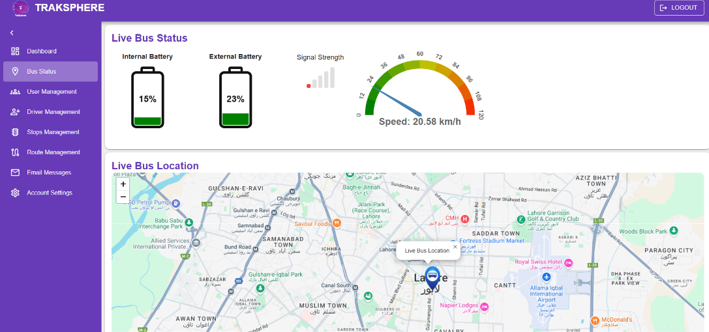
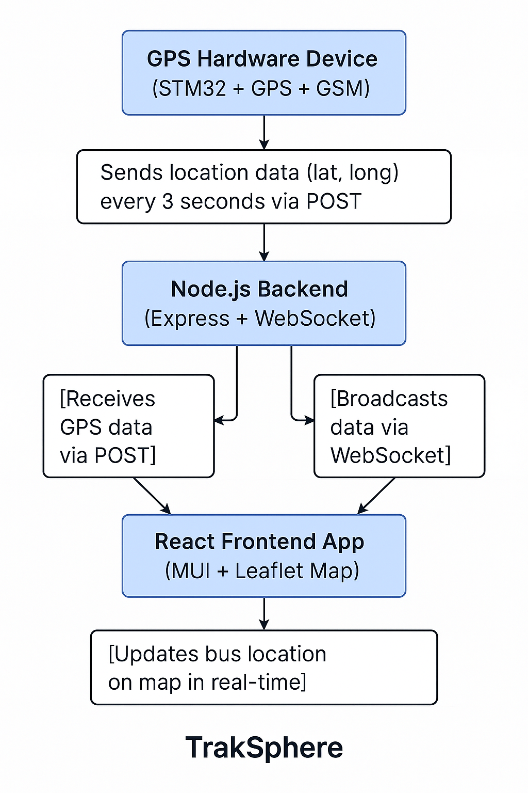
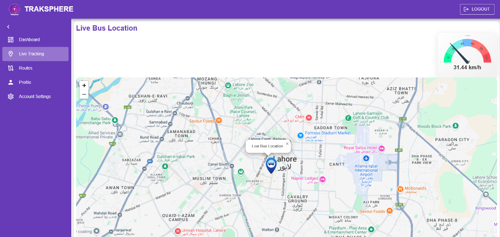
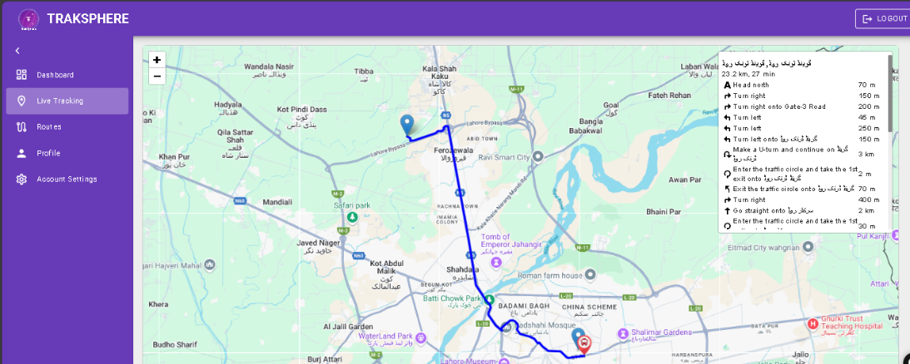
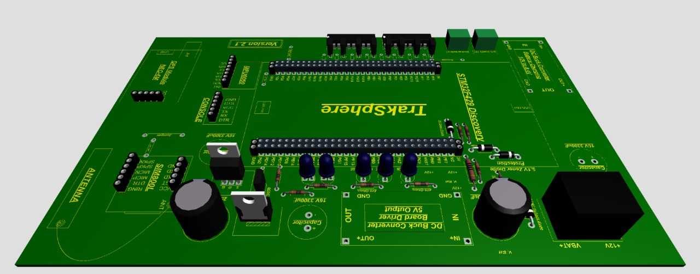
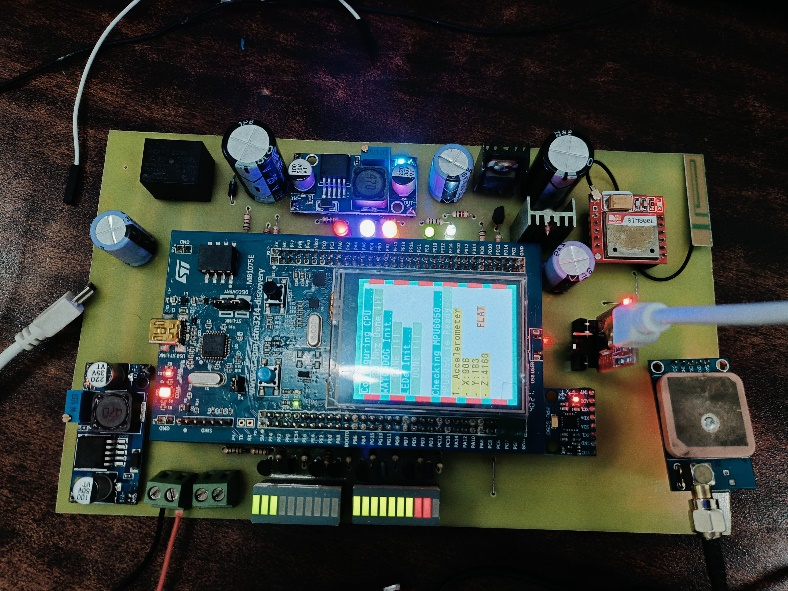

# Trak-Sphere: Real-Time Vehicle Tracking with GPS and GSM

> A complete tracking product, from a custom circuit board to a live web dashboard, built for university bus fleets.
> **Ranked 4th** among all final-year projects of my department (2025).



## Highlights

- **Location on the map within 3–5 seconds** of the vehicle moving (real driving test)
- **Custom PCB** designed in Proteus, then etched, drilled and soldered by hand
- **Full stack:** STM32 firmware → REST API → PostgreSQL → WebSocket → React map
- Live map, route history, admin and user dashboards, JWT sign-in

## How it works



| Layer | Technology |
|---|---|
| Tracker | STM32F429, NEO-6M GPS, SIM800L GSM/GPRS, MPU6050, TFT display, LM2596 buck converter |
| Firmware | Embedded C, IAR Embedded Workbench |
| Back end | Node.js, Express, TypeORM, PostgreSQL, Redis, WebSocket, JWT |
| Front end | React, TypeScript, Vite, Material UI, Leaflet |

## Repository structure

```
firmware/prototype/   STM32F429 prototype firmware (Embedded C)
hardware/pcb/         Proteus project of the tracker board (v2)
web/backend/          Node.js + Express API, PostgreSQL via TypeORM
web/frontend/         React + TypeScript dashboard
docs/images/          Diagrams and screenshots
```

## Run the web platform

```bash
# Back end
cd web/backend
cp .env.example .env      # fill in your own database, JWT and email settings
npm install
npm run migration:run
npm run dev

# Front end (new terminal)
cd web/frontend
npm install
npm run dev
```

## Screenshots

| Live location | Route view |
|---|---|
|  |  |

| PCB (3D) | Assembled tracker |
|---|---|
|  |  |

## Credits

Final-year group project (team of three). My part: the tracking device including the custom PCB, and the web platform.
Landing-page illustrations come from free stock-illustration libraries.

## Licence

Copyright © 2025 Muhammad Asad Nadeem. All rights reserved.
The code is shared for viewing as part of my engineering portfolio. Please contact me before reusing it.
